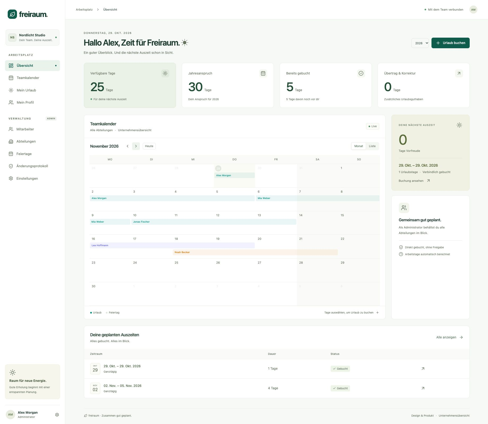

# freiraum. — Urlaubsplaner

Interne Urlaubsverwaltung für ein Unternehmen mit mehreren Abteilungen. Node.js/Express, React/Vite, Tailwind, FullCalendar und Prisma/SQLite. Eine Anwendung, ein Docker-Dienst, ein persistentes Datenvolume.



## Funktionen

- Persönliche Anmeldung, sichere Cookie-Sessions, Aktivierungs-/Resetlinks und Adminrolle.
- Dashboard, Monats-/Wochen-/Listen-/Jahreskalender, Urlaub direkt per Auswahl oder Formular buchen.
- Sofort verbindliche Buchung ohne Freigabe; Mitarbeiter sehen ausschließlich ihre aktuelle Abteilung. Admins sehen alle Abteilungen.
- Ganze/halbe Tage, individuelle Wochenarbeitstage, Standortfeiertage und jahresübergreifende Buchungen.
- Persönliche Jahreskonten, Guthabenkorrekturen, Überträge, Ablaufdaten und Jahresabschluss.
- Änderungen und Stornos mit atomarer Kontierung, Versionsprüfung, Idempotenz und Audit.
- Verwaltung von Mitarbeitern, Abteilungen, Arbeitsplänen, Feiertagen und Firmenparametern. Auswirkungen geänderter Arbeitspläne/Feiertage vor dem Speichern prüfen.
- Docker Compose mit Healthcheck, Benutzer ohne root, schreibgeschütztem Root-Dateisystem und persistentem SQLite-Volume. Backup mit Integritätsprüfung.

## Schnellstart mit Docker

Voraussetzungen: Docker mit Compose. Im Projektverzeichnis:

```sh
cp .env.example .env
docker compose up -d --build
docker compose exec app npm run bootstrap
```

Das Bootstrap-Kommando fragt Name, E-Mail und ein eigenes Passwort (mindestens 12 Zeichen, verdeckte Eingabe) ab. Es funktioniert nur, wenn noch kein Admin existiert. Keine Standardpasswörter, keine öffentliche Registrierung.

Anschließend [http://localhost:3000](http://localhost:3000) öffnen. Im Adminbereich zuerst die Feiertage für den Hauptstandort und das benötigte Jahr eintragen und deren Vollständigkeit bestätigen. Danach Mitarbeiter anlegen und über **Zugangslink** einen persönlichen Einmallink erzeugen. Neue Mitarbeiter bekommen einen Wochenplan und das gewählte Jahreskonto.

Daten liegen im benannten Volume `app-data`. `docker compose down` erhält die Daten. `docker compose down -v` entfernt das Volume und alle darin gespeicherten Daten.

### Hinter einem HTTPS-Proxy

In `.env` die tatsächliche Origin und sichere Cookies setzen:

```dotenv
APP_ORIGIN=https://urlaub.example.org
COOKIE_SECURE=true
TRUST_PROXY=true
HOST_PORT=3000
```

Nur `TRUST_PROXY=true` verwenden, wenn exakt ein vertrauenswürdiger Reverse-Proxy vorgeschaltet ist. Compose bindet den Port an die Host-Loopbackadresse; ein Proxy auf dem Host kann ihn weiterleiten. Ein Proxy in einem anderen Container benötigt eine entsprechend angepasste Netzwerkverbindung. Die App akzeptiert schreibende Browseranfragen nur von `APP_ORIGIN`. HTTP in Produktionskonfiguration ist ausschließlich für localhost erlaubt.

### Lokaler Docker-Desktop-Sonderfall

Falls eine alte, root-eigene Datei `~/.docker/buildx/current` den Compose-Build mit „permission denied“ blockiert, kann der vorhandene Builder explizit gewählt werden, ohne Dateirechte zu ändern:

```sh
docker build --builder desktop-linux -t urlaubsplaner:local .
docker compose up -d --no-build
```

Das ist ein lokaler Docker-Konfigurationsfehler; auf einem normal eingerichteten Docker-Host genügt der Schnellstart.

## Entwicklung und Demo

Node.js 24 LTS und npm verwenden. Prisma-CLI, Client und SQLite-Adapter sind gemeinsam auf 7.10.1 fixiert; das Lockfile fixiert alle weiteren Versionen.

```sh
cp .env.example .env
npm ci
npm run db:generate
npm run db:migrate
npm run bootstrap
npm run dev
```

Frontend: [http://localhost:5173](http://localhost:5173), Express: Port 3000. Der Dev-Start setzt die zugelassene Origin auf `http://localhost:5173`; `DEV_ORIGIN` erlaubt einen ausdrücklich konfigurierten Ersatz. Vite verwendet einen festen Port und leitet `/api` an Express weiter.

Für eine **leere lokale** Datenbank kann statt `bootstrap` einmalig `npm run demo` ausgeführt werden. Das erzeugt fünf synthetische Mitarbeiter in drei Abteilungen, zwei Jahreskonten je Person und Demobuchungen. Die Zugangsnamen sind `admin@example.test` und `mia@example.test`; ein zufälliges gemeinsames Demopasswort wird einmalig im Terminal ausgegeben. Der Seed verweigert bestehende Benutzerdaten. Der Demokalender enthält nur bundeseinheitliche deutsche Feiertage und muss für echte Standorte vervollständigt werden.

Gebauter lokaler Betrieb:

```sh
npm run build
npm start
```

Hier gilt `APP_ORIGIN` aus `.env`, im Beispiel `http://localhost:3000`.

## Fachliche Regeln

- Im Formular ist der letzte Urlaubstag **inklusive**. FullCalendar verwendet intern ein exklusives Ende; der Adapter übernimmt die Umrechnung.
- 1 interne Einheit = 0,5 Tage. Ein voller individueller Arbeitstag zählt als zwei Einheiten, unabhängig von seiner Stundenzahl.
- Neue Buchungen ab heute; Mitarbeiter ändern/stornieren ausschließlich vollständig zukünftige Buchungen. Admins können rückwirkend und für andere Personen mit Begründung eingreifen.
- Feiertagsjahre müssen ausdrücklich bestätigt und Jahreskonten vorhanden/offen sein. Fehlende Konfiguration wird nicht geraten.
- Jahresabschluss erst nach Jahresende. Übertrag nur einmal, in ein offenes Folgejahreskonto; ein geschlossenes Jahr wird nicht wieder geöffnet. Ausgelaufenes Guthaben wird nicht übertragen.
- Arbeitsplanwechsel beginnen in der Zukunft und schließen den vorherigen Plan am neuen Startdatum. Feiertags- und Planänderungen werden zunächst in einer zurückgerollten Transaktion geprüft; Speichern prüft den Vorschauzustand erneut und berechnet betroffene Zukunftsbuchungen atomar neu.
- Historische Buchungen bleiben erhalten. Änderungen, die laufenden Urlaub, geschlossene Kontojahre oder eine vollständig unbuchbar werdende Buchung betreffen, werden abgewiesen und verlangen eine ausdrückliche fachliche Korrektur.
- Bei Abteilungswechsel richtet sich auch die Sichtbarkeit historischer Kalenderereignisse nach der **aktuellen** Abteilung. Eigene Buchungen bleiben persönlich zugänglich.
- Arbeitsrechtliche Anspruchsquoten, Verfallsregeln und Aufbewahrungsfristen legt das Unternehmen fest. Ansprüche werden durch Admins gepflegt.

## Tests und Qualität

```sh
npm run check
npm test
npm run build
npm audit --audit-level=high
npm run benchmark
```

Die Integrationstests verwenden echte, isolierte SQLite-Dateien und prüfen unter anderem Fremdzugriffe, CSRF, Resetlinks, Teilzeit, Halbtage, Feiertage, Stornos, Idempotenz, Rollback, Jahreswechsel und parallele Buchungen über getrennte Prisma-Verbindungen. Der Benchmark erzeugt ausschließlich eine temporäre synthetische Datenbank mit 500 Benutzern, 25.000 Buchungen und 20 parallelen Sitzungen.

Browser-E2E-Tests für CI:

```sh
npx playwright install chromium
npm run build
npm run test:e2e
```

Die E2E-App läuft ausschließlich auf `127.0.0.1:4173` mit einer eigenen temporären Datenbank. Eine Desktop-Browserprüfung und die responsive Prüfung bei 360 px sind außerdem im [Prüfprotokoll](docs/PRUEFPROTOKOLL.md) dokumentiert.

## Backup, Wiederherstellung und Updates

Lokale Sicherung:

```sh
npm run backup
npm run restore:check -- backups/DATEINAME.db
```

Im Container:

```sh
docker compose exec -e BACKUP_DIR=/app/data/backups app npm run backup
```

Die Backup-API erstellt einen konsistenten SQLite-Snapshot, prüft Foreign Keys und Integrität. `restore:check` kopiert eine Sicherung in ein temporäres Verzeichnis und prüft sie dort einschließlich Kontoüberziehungen. Backups zusätzlich regelmäßig verschlüsselt vom Docker-Host wegkopieren; eine Sicherung im selben Volume allein schützt nicht vor Host-/Volumeverlust.

Wiederherstellung bei **gestoppter App**:

1. `docker compose stop app` ausführen.
2. Das bestehende Volume vorab separat sichern. Die gewünschte, mit `restore:check` geprüfte `.db` in das Volume unter `/app/data/urlaubsplaner.db` kopieren; alte zu dieser Datenbank gehörige `-wal`-/`-shm`-Dateien dürfen nicht mit einer anderen Sicherung vermischt werden. Dateirechte für UID/GID 1000 erhalten.
3. `docker compose up -d` starten; Healthcheck, Anmeldung, Kontostände und Stichproben von Buchungen prüfen.

Vor Updates Backup erstellen, dann `git pull` und `docker compose up -d --build`. Versionierte Prisma-Migrationen laufen vor dem Serverstart; bei Migrationsfehlern startet der Server nicht. Ein Container-Rollback ersetzt kein Datenbank-Rollback. Startziele: tägliche externe Sicherung (RPO ≤24 h) und monatlich geübter Restore (RTO ≤4 h).

## GitHub Actions und Dependabot

- **Docker build:** Image-Build bei Pull Requests/Pushes und manuell; keine Registry-Veröffentlichung und kein automatisches Deployment.
- **Tests and lint:** Lint, echte SQLite-Tests, Frontend-Build, Browser-E2E, Migration-/Backup-Smoke-Test und Abhängigkeitsprüfung unter Node 24.
- **Dependabot:** GitHub Actions, npm-Workspaces und Docker-Basisimage, wöchentlich montags um 07:00 Uhr Europe/Berlin. Zusammengehörige Prisma-Pakete werden gemeinsam aktualisiert.
- **Auto-Merge:** Nur verifizierte Dependabot-Patch-/Minor-Updates im selben Repository gegen den Standardbranch. Docker-Build, Tests/Lint und alle verpflichtenden Branchchecks müssen erfolgreich sein; ohne Pflichtchecks kein automatischer Merge. Major-Updates bleiben manuell. Der privilegierte Merge-Workflow führt keinen PR-Code aus.

Einmalig in GitHub: **Allow auto-merge** und **Squash merging** aktivieren. Den Standardbranch mit Pull-Request-Pflicht, aktuellem Branchstand und Pflichtchecks **Docker build** sowie **Tests and lint** schützen. Verlangte manuelle Reviews werden nicht umgangen. Organisationsregeln müssen die verwendeten Actions und Schreibrechte für den Merge-Workflow zulassen.

## Projektunterlagen

- [Technischer Umsetzungsplan](docs/TECHNISCHER_UMSETZUNGSPLAN.md) – ursprüngliche Projektgrundlage.
- [OpenAPI-Vertrag](docs/openapi.yaml) – implementierte Routen; angemeldet auch unter `/api/v1/openapi`.
- [Prüfprotokoll](docs/PRUEFPROTOKOLL.md) – ausgeführte Prüfungen und bekannte Grenzen.
- [Prisma-Schema](prisma/schema.prisma) und versionierte SQL-Migrationen – einschließlich CHECKs, Unique-Indizes und Integritätstriggern.
