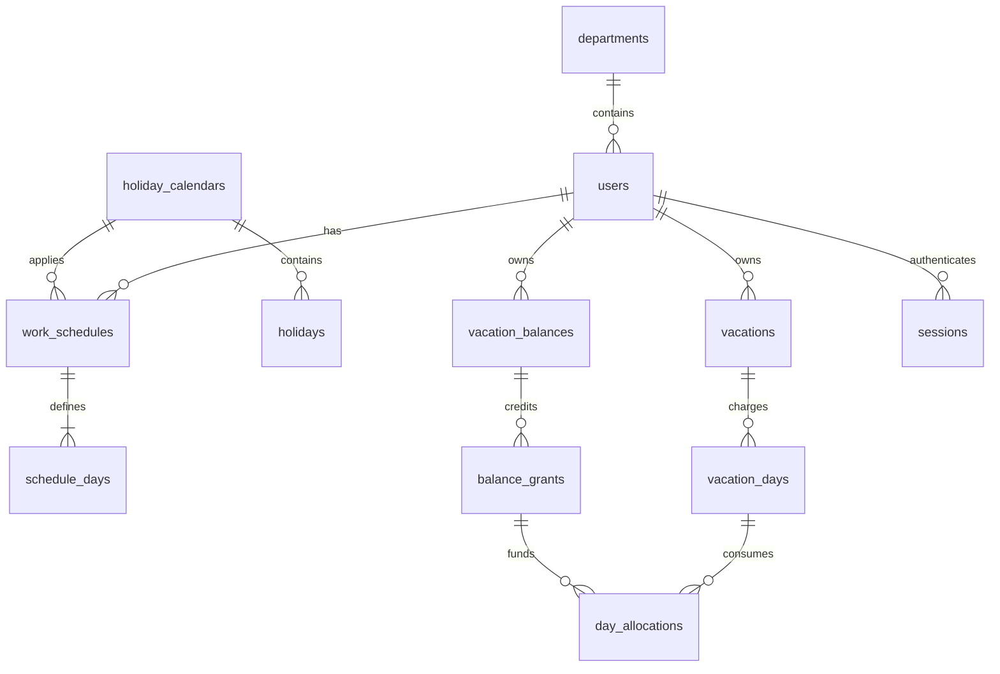

# Technischer Umsetzungsplan – Urlaubsplaner

Stand: 29. Oktober 2026. Status: Projektgrundlage, noch keine implementierte Anwendung.

## 1. Ziel und verbindliche Architektur

Eine interne Webanwendung für **ein Unternehmen** mit mehreren Abteilungen. Mitarbeiter buchen eigenen Urlaub direkt im Kalender. Gültige Buchungen sind unmittelbar verbindlich; es gibt weder Freigabeprozess noch wartende Anträge. Mitarbeiter sehen im Teamkalender ausschließlich ihre aktuelle Abteilung. Administratoren verwalten alle Abteilungen und Konten.

Der Plan übernimmt die Architektur aus „Urlaubsplaner Vorschlag Nodejs“: React/Vite, Tailwind und FullCalendar im Frontend; Node.js/Express mit Session-Anmeldung im Backend; SQLite mit Prisma; Docker Compose mit **einem Anwendungsdienst**, der API und gebaute SPA ausliefert, sowie persistentem Datenvolume. Kein separater Datenbankserver.

```text
Browser ── HTTPS ── vorhandener TLS-Reverse-Proxy
                          │
                    Express / ein Container
                    ├── /api/v1/* → Auth → Rechte → Services → Prisma
                    └── /*        → React-Build
                                                        │
                                           /app/data/urlaubsplaner.db
                                           lokales Docker-Volume
```

Der TLS-Proxy ist vorhandene Betriebsinfrastruktur; optional kann später ein Proxy-Dienst ergänzt werden. Entwicklung: Vite mit Proxy auf Express. Produktion: gleiche Origin für SPA und API.

### Festlegungen für Version 1

- JavaScript mit ES-Modulen in Frontend und Backend, JSDoc für zentrale Verträge; keine zusätzliche Framework-Schicht.
- Unterstützte Node-LTS-Version und miteinander kompatible stabile Paketversionen bei Projektstart prüfen, dann mit Lockfile und Container-Digest fixieren. Ausgangspunkt aus dem Vorgängerchat: Node 24 LTS. Prisma-CLI, Client und gegebenenfalls SQLite-Adapter müssen zusammenpassen.
- Rollen `EMPLOYEE` und `ADMIN`; ein Benutzer gehört genau einer aktuellen Abteilung an.
- Status ausschließlich `BOOKED` und `CANCELLED`; automatische Buchung ist keine nachträgliche Admin-Freigabe.
- Ganze Tage und halbe Tage am Vormittag/Nachmittag. Ein Urlaubstag bezieht sich auf den individuellen geplanten Arbeitstag, nicht auf acht Arbeitsstunden.
- Individuelle feste Wochenarbeitstage, Feiertagskalender je Arbeitsort, Beschäftigungsbeginn/-ende und Jahreskonten.
- Jahresübergreifende Buchungen werden unterstützt; fehlendes Konto eines betroffenen Jahres blockiert die Buchung.
- Rückwirkende Buchungen/Änderungen nur durch Admin mit Begründung. Mitarbeiter dürfen ab dem heutigen Datum buchen und nur vollständig zukünftige Buchungen selbst ändern oder stornieren.
- Ansprüche, Eintritts-/Austrittsquoten und Überträge werden vom Admin festgelegt. Keine automatische arbeitsrechtliche Anspruchsbestimmung. Standard: Übertrag ohne automatischen Verfall; konfigurierbare Ablaufdaten sind technische Kontoregeln.
- Betriebsferien mit automatischen Sammelabbuchungen, Krankheit, Genehmigungen, E-Mail-Versand, SSO, iCal und PWA sind spätere Erweiterungen. Jahresübersicht in V1 als zwölf Monatsraster; kein kostenpflichtiges Ressourcenplanungsmodul erforderlich.

## 2. Projektstruktur und Verantwortlichkeiten

```text
urlaubsplaner/
├── package.json                 # npm workspaces, gemeinsame Skripte
├── package-lock.json
├── backend/
│   ├── package.json
│   ├── src/
│   │   ├── server.js            # Start, Shutdown, Konfigurationsprüfung
│   │   ├── app.js               # Express, /api/v1, SPA-Fallback
│   │   ├── config/              # env, Prisma, Logging
│   │   ├── routes/              # auth, me, calendar, vacations, admin
│   │   ├── middleware/          # session, csrf, authorization, errors
│   │   ├── validators/          # Zod-Schemas, Query-/Body-Validierung
│   │   ├── repositories/        # ausschließlich scoped Datenzugriff
│   │   ├── services/
│   │   │   ├── vacation.service.js
│   │   │   ├── balance.service.js
│   │   │   ├── calendar.service.js
│   │   │   ├── schedule.service.js
│   │   │   └── audit.service.js
│   │   └── utils/               # Date-only-Rechnung, halbe Tage
│   └── tests/                   # Unit-/API-/Parallelitätstests
├── frontend/
│   ├── package.json
│   ├── index.html
│   ├── vite.config.js
│   └── src/
│       ├── App.jsx
│       ├── components/          # Calendar, BookingDialog, BalanceCard
│       ├── pages/               # Login, Dashboard, Calendar, MyLeave, Admin
│       ├── layouts/
│       ├── hooks/
│       ├── services/            # fetch-Client, CSRF, Fehlerabbildung
│       └── styles/              # Tailwind, Design-Tokens
├── prisma/
│   ├── schema.prisma
│   ├── migrations/              # inklusive SQL-Constraints/Trigger
│   └── seed.js                  # ausschließlich explizite Demo-/Testdaten
├── tests/e2e/                   # Playwright
├── scripts/                     # bootstrap-admin, backup, restore-check
├── docs/
│   ├── TECHNISCHER_UMSETZUNGSPLAN.md
│   └── openapi.yaml             # in Phase 1 anzulegen
├── data/.gitkeep                # DB-Dateien gitignored
├── Dockerfile
├── compose.yaml
├── .dockerignore
├── .env.example
└── README.md
```

Routes verarbeiten HTTP, Validatoren prüfen Formate, Services enthalten Geschäftsregeln, Repositories binden Berechtigungsfilter und Prisma. Kalender und Konten verwenden denselben Berechnungsservice. Kein Fachregel-Duplikat im Frontend. Testwerkzeuge: Vitest, Supertest und Playwright.

## 3. Relationales Datenmodell

### 3.1 Konventionen und Beziehungen

Alle Tabellen verwenden `id TEXT PRIMARY KEY` mit serverseitiger UUID, sofern nicht anders angegeben. Pflichtfelder sind `NOT NULL`; ausdrücklich mit `?` markierte Felder sind nullable. Zeitpunkte sind UTC, in Prisma `DateTime`. Fachliche Kalendertage sind `TEXT` als streng geprüftes `YYYY-MM-DD` ohne Uhrzeit. Damit hängt Urlaub weder von Sommerzeit noch UTC-Konvertierungen ab. Tabellen-/Spaltennamen in SQL snake_case, Prisma-Mapping mit `@@map`/`@map`.

Geldähnliche Tagesmengen werden als **ganze Halbtagseinheiten** gespeichert: 1 = 0,5 Tage, 2 = 1 Tag. Keine Fließkommazahlen. Buchungs- und Kontobewegungen werden historisch aufbewahrt; Stammdaten werden deaktiviert/archiviert statt kaskadierend gelöscht.



### 3.2 Stammdaten und Anmeldung

| Tabelle | Felder und Bedeutung | Constraints und Indizes |
|---|---|---|
| `departments` | `id`, `name`, `name_key`, `color`, `archived_at?`, `created_at`, `updated_at` | `UNIQUE(name_key)`; normalisierter Namensschlüssel; Archivieren nur ohne aktive Mitglieder |
| `users` | `id`, `email`, `email_key`, `display_name`, `password_hash`, `role`, `department_id`, `is_active`, `employment_start`, `employment_end?`, `must_change_password`, `auth_version`, `version`, Zeitstempel | `UNIQUE(email_key)`; Rolle CHECK in EMPLOYEE/ADMIN; Bool-CHECKs; `employment_end IS NULL OR employment_end >= employment_start`; FK department RESTRICT; Index `(department_id,is_active)` |
| `sessions` | `id` = Hash des zufälligen Sessiontokens, `user_id`, `auth_version`, `created_at`, `last_seen_at`, `expires_at`, `absolute_expires_at`, `csrf_secret` | FK user CASCADE; Index `(user_id)`, `(expires_at)`; Zeitfolgen-CHECK; keine Klartext-Sessiontokens in DB oder Logs |
| `password_tokens` | `id`, `token_hash`, `user_id`, `purpose` (ACTIVATE/RESET), `expires_at`, `used_at?`, `created_at` | `UNIQUE(token_hash)`; FK user CASCADE; Index `(user_id,purpose)`, `(expires_at)`; einmalige Nutzung atomar |
| `holiday_calendars` | `id`, `code`, `name`, `timezone`, `archived_at?` | `UNIQUE(code)`; z. B. Kalender eines Standorts; gültige IANA-Zeitzone |
| `holiday_years` | `id`, `calendar_id`, `year`, `state` (DRAFT/READY), `version`, `confirmed_by?`, `confirmed_at?` | FK calendar RESTRICT, confirmed_by SET NULL; `UNIQUE(calendar_id,year)`; Jahresbereich 1900–9999; READY nur mit Bestätigungsdaten |
| `holidays` | `id`, `holiday_year_id`, `date`, `name`, `blocked_slots` (AM/PM/FULL) | FK holiday_year RESTRICT; `UNIQUE(holiday_year_id,date)`; Datum muss zum Kalenderjahr gehören; Index durch UNIQUE abgedeckt |

E-Mail-Schlüssel: trimmen und nach festgelegter Firmenregel kleinschreiben. Bei Mehrdeutigkeit mit vorhandenem Konto ablehnen. Anzeigenamen sind nicht eindeutig. Aktive Benutzer dürfen keiner archivierten Abteilung angehören. Login prüft immer aktuellen Aktivstatus und `auth_version`, nicht nur Sessiondaten. Der letzte aktive Admin kann weder deaktiviert noch herabgestuft werden; Transaktionsregel.

### 3.3 Individuelle Arbeitstage

| Tabelle | Felder | Constraints und Indizes |
|---|---|---|
| `work_schedules` | `id`, `user_id`, `valid_from`, `valid_to?` exklusiv, `holiday_calendar_id`, `version`, Zeitstempel | FKs user/calendar RESTRICT; CHECK `valid_to IS NULL OR valid_to > valid_from`; `UNIQUE(user_id,valid_from)`; Index `(user_id,valid_from,valid_to)` |
| `schedule_days` | `id`, `schedule_id`, `weekday` (1=Mo bis 7=So), `is_workday` | FK schedule RESTRICT; `UNIQUE(schedule_id,weekday)`; CHECK weekday 1–7, Bool-CHECK |

Jeder Plan enthält genau sieben Wochentage. Ein geplanter Arbeitstag kostet bei Ganztagsurlaub zwei Einheiten, auch bei vier Stunden täglicher Arbeitszeit. AM/PM teilen den individuellen Arbeitstag in zwei gleiche Abschnitte. Stundengenaue Modelle und wechselnde Schichtpläne sind nicht Teil von V1.

Gültigkeitsintervalle dürfen sich je Benutzer nicht überschneiden. Für jeden zu buchenden Tag muss genau ein Plan existieren; Lücken führen zu einem Fehler. Sieben-Tage-Vollständigkeit und Intervallprüfung erfolgen im Service; Überschneidungen zusätzlich über SQLite-Trigger für INSERT/UPDATE. Künftige Plan- oder Feiertagsänderungen mit betroffenen Buchungen erfordern eine explizite Vorschau und atomare Neuberechnung. Ebenso werden Beschäftigungszeitraumänderungen gegen bestehende Buchungen geprüft; kollidierende Änderungen sind ohne vorherige ausdrückliche Buchungskorrektur gesperrt. Änderungen an geschlossenen Kontojahren werden abgelehnt. Bereits vergangene Buchungen bleiben unverändert; rückwirkende Korrekturen erfolgen ausschließlich ausdrücklich durch Admin.

### 3.4 Urlaubskonten und Guthaben

`vacation_balances` ersetzt den ursprünglich vorgeschlagenen einfachen Summensatz durch ein Jahreskonto mit nachvollziehbaren Guthabenquellen. Der Reststand wird berechnet, nicht als frei änderbare Zahl gespeichert.

| Tabelle | Felder | Constraints und Indizes |
|---|---|---|
| `vacation_balances` | `id`, `user_id`, `year`, `state` (OPEN/CLOSED), `version`, Zeitstempel | FK user RESTRICT; `UNIQUE(user_id,year)`; CHECK Jahresbereich; kein negativer Kontostand |
| `balance_grants` | `id`, `balance_id`, `kind` (ANNUAL/CARRYOVER/ADJUSTMENT), `granted_units`, `withdrawn_units`, `valid_from`, `expires_on?` inklusiv, `source_balance_id?`, `reason`, `created_by`, Zeitstempel | FKs balance/source_balance/user RESTRICT; CHECK granted > 0, withdrawn zwischen 0 und granted; expires >= valid_from; Index `(balance_id,expires_on,valid_from)`; teilweiser UNIQUE auf `balance_id` für ANNUAL; teilweiser UNIQUE `(balance_id,source_balance_id)` für CARRYOVER |
| `balance_grant_changes` | `id`, `grant_id`, `delta_granted_units`, `delta_withdrawn_units`, `reason`, `actor_id`, `created_at` | FKs RESTRICT; mindestens ein Delta ungleich 0; Index `(grant_id,created_at)`; append-only |

Initialanlage und spätere Korrektur erzeugen immer eine Änderungszeile und passen den Guthabensatz in derselben Transaktion an. Aggregierte Werte müssen der Summe ihrer Änderungszeilen entsprechen. Negative Korrekturen erhöhen `withdrawn_units` oder reduzieren nachweisbar ungenutztes Guthaben; bereits zugeteilte Einheiten dürfen nicht entzogen werden. Positive Korrekturen erzeugen einen eigenen ADJUSTMENT-Satz. Jede Korrektur verlangt eine Begründung.

Guthaben muss für das Konto-Jahr gelten; seine Gültigkeitsdaten liegen innerhalb dieses Jahres. CHECK: `source_balance_id` ist genau bei CARRYOVER gesetzt, sonst NULL. CARRYOVER verweist auf das unmittelbare Vorjahreskonto desselben Benutzers. Übertrag erfolgt nur aus einem geschlossenen Vorjahr, atomar und wiederholsicher, höchstens in Höhe seines ungenutzten Guthabens. Geschlossene Jahre sind für Änderungen gesperrt. Erneutes Öffnen nach Übertrag ist in V1 gesperrt; Korrekturen erfolgen begründet im offenen Folgejahr. So entsteht kein doppeltes Guthaben. Jahresabschluss ist ein expliziter Adminvorgang, kein blindes Kopieren beim Jahreswechsel.

### 3.5 Buchungen, einzelne Tage und Belegung

| Tabelle | Felder | Constraints und Indizes |
|---|---|---|
| `vacations` | `id`, `user_id`, `start_date`, `end_date` inklusiv, `start_part`, `end_part` (FULL/AM/PM), `status`, `private_note?`, `created_by`, `updated_by`, `cancelled_by?`, `cancelled_at?`, `cancel_reason?`, `version`, Zeitstempel | FKs user/actors RESTRICT; CHECK end >= start, gültige Werte; BOOKED ohne Stornofelder, CANCELLED mit Zeitpunkt/Akteur; Index `(user_id,status,start_date,end_date)`, `(status,start_date,end_date)` |
| `vacation_days` | `id`, `vacation_id`, `date`, `schedule_id`, `holiday_year_version`, `calculation_version`, `units` (1/2) | FKs vacation/schedule RESTRICT; `UNIQUE(vacation_id,date)`; CHECK units IN (1,2); nur tatsächlich belastete Arbeitstage; Index `(date)` |
| `day_allocations` | `id`, `vacation_day_id`, `grant_id`, `units`, `released_at?`, `created_at` | FKs day/grant RESTRICT; CHECK units IN (1,2); `UNIQUE(vacation_day_id,grant_id)`; Index `(grant_id,released_at)` |
| `vacation_slots` | `id`, `vacation_day_id`, `user_id`, `date`, `slot` (AM/PM) | FKs day/user RESTRICT; `UNIQUE(user_id,date,slot)`; `UNIQUE(vacation_day_id,slot)`; nur aktive Belegungen |

`vacation_slots` verhindert konkurrierende Doppelbelegung per Datenbank-UNIQUE. Ganze Tage erzeugen zwei Slots, halbe einen. `vacation_days` und `day_allocations` bewahren die Berechnung. Beim Storno werden Slots gelöscht und Zuteilungen mit `released_at` freigegeben; Tageszeilen und Buchung bleiben erhalten. Änderungen einer Buchung ersetzen die Tages-/Zuteilungszeilen in einer Transaktion (zuerst Slots/Zuteilungen, dann Tage entfernen; keine implizite Kaskade); der vorherige Stand einschließlich Aufteilung wird im Audit festgehalten.

Zuteilungen müssen zum Benutzer und Jahr des Urlaubstages gehören, innerhalb des Gültigkeitszeitraums des Guthabens liegen und zusammen exakt `vacation_days.units` ergeben. Slot-Anzahl muss identisch sein. Kein Guthaben darf durch aktive Zuteilungen überzogen werden. Diese tabellenübergreifenden Regeln erzwingt der zentrale Transaktionsservice; Trigger schützen zusätzlich Slot-Zuordnung (Benutzer/Datum/BOOKED-Status). Normale CHECKs können diese Regeln nicht allein ausdrücken.

Private Notizen werden ausschließlich Eigentümer und Admin angezeigt, niemals im Teamkalender. Keine Gesundheitsdaten als Buchungstyp.

### 3.6 Konfiguration, Wiederholsicherheit und Audit

| Tabelle | Felder | Constraints und Indizes |
|---|---|---|
| `settings` | `id` fest `company`, `company_name`, `timezone`, `default_allowance_units`, `max_booking_days`, `version`, `updated_by`, `updated_at` | CHECK id='company', allowance >= 0, max_booking_days 1–366; FK actor RESTRICT; Modi automatic/department sind in V1 feste Produktregeln |
| `idempotency_keys` | `id`, `actor_id`, `key`, `operation`, `request_hash`, `resource_id?`, `result_json`, `created_at`, `expires_at` | FK actor RESTRICT; `UNIQUE(actor_id,key)`; Index expires_at; gleiche Anfrage liefert ursprüngliches Ergebnis, anderer Body mit gleichem Key 409 |
| `audit_logs` | `id`, `actor_id?`, `action`, `entity_type`, `entity_id`, `subject_user_id?`, `before_json?`, `after_json?`, `reason?`, `request_id`, `created_at` | FK actor/subject SET NULL; Index `(entity_type,entity_id,created_at)`, `(actor_id,created_at)`, `(subject_user_id,created_at)`; JSON-valid-CHECK, sofern Laufzeit unterstützt |

Audit umfasst Buchung, Änderung, Storno, Kontokorrektur, Jahresabschluss, Plan-/Feiertagsänderungen, Rollen- und Abteilungswechsel. Keine Passwörter, Token oder Sessioninhalte im Audit. Auditdaten bleiben für die normale Anwendung append-only; Hostadministratoren sind damit nicht kryptografisch ausgeschlossen. Datenschutzbereinigung erfolgt separat und dokumentiert.

### 3.7 Umsetzung der Constraints mit Prisma und SQLite

- Prisma modelliert Beziehungen, Pflichtfelder, eindeutige Schlüssel und reguläre Indizes. Echte Foreign Keys verwenden; auf jeder produktiven Verbindung deren Aktivierung prüfen.
- CHECKs, Trigger und bei Bedarf partielle UNIQUE-Indizes in versionierten SQL-Migrationen ergänzen, falls die gewählte Prisma-Version sie nicht vollständig ausdrückt. Keine ausschließlich im UI implementierten Integritätsregeln.
- Beispiel für zusätzliche SQL-Regeln:

```sql
CREATE UNIQUE INDEX one_annual_grant
  ON balance_grants(balance_id) WHERE kind = 'ANNUAL';
CREATE UNIQUE INDEX one_carryover_per_source
  ON balance_grants(balance_id, source_balance_id)
  WHERE kind = 'CARRYOVER';
-- Beispiel einer Tabellendefinition, nicht nachträgliches ALTER CONSTRAINT:
-- CHECK (units IN (1, 2))
-- CHECK (end_date >= start_date)
-- UNIQUE (user_id, date, slot)
```

Datumformat wird per SQL-CHECK auf Länge/Form und zusätzlich serverseitig auf reale Kalendertage geprüft. Enum-/Boolean-Werte bekommen CHECKs. Sämtliche Mengen sind SQLite INTEGER mit Integritätsprüfungen; API akzeptiert nur sichere Ganzzahlen. UUID-Felder, Metadaten und Versionen sind nicht clientseitig überschreibbar. `version` wird bei konkurrierenden Änderungen geprüft und atomar erhöht.

Migrationstests prüfen auf einer echten SQLite-Datei die Existenz und Wirkung aller Constraints/Trigger, insbesondere nach Tabellenneuanlage. Entwicklung per Prisma-Migrationen, Produktion ausschließlich versionierte Deployment-Migrationen; kein `db push` gegen Produktivdaten. Prisma beschreibt das Ergänzen von nicht modellierbaren Datenbankfunktionen in [angepassten Migrationen](https://www.prisma.io/docs/orm/v7/prisma-migrate/workflows/unsupported-database-features). Die genaue API wird gegen die gewählte und fixierte Prisma-Version umgesetzt.

## 4. Rollen, Sichtbarkeit und Abteilungswechsel

| Aktion/Daten | Mitarbeiter | Admin |
|---|---|---|
| Persönliche Stammdaten, eigenes Konto/Urlaub | eigene | alle |
| Urlaub buchen/ändern/stornieren | eigene, Zeitregeln beachten | alle, Begründung bei fremden/rückwirkenden Änderungen |
| Teamkalender | aktuelle eigene Abteilung | alle, optional Abteilungsfilter |
| Kollegeninformationen | Name, Abteilung, Urlaubstage/-abschnitt | zusätzlich administrative Daten |
| Kontostände, E-Mail, private Notizen von Kollegen | kein Zugriff | Zugriff |
| Benutzer/Rollen/Abteilungen/Pläne/Feiertage/Konten | kein Schreibzugriff | verwalten |
| Audit und Firmenkonfiguration | kein Zugriff | lesen bzw. konfigurieren |

Die API lädt Rolle, Aktivstatus und aktuelle Abteilung aus der Datenbank. Mitarbeiter können `departmentId` oder `userId` nicht als alternative Berechtigung verwenden. Ein abweichender Abteilungsfilter wird mit 403 abgelehnt. Fremde Detailobjekte liefern 404, damit keine Existenzinformation preisgegeben wird. Auch Exporte, Suchfunktionen, Summen und Fehlermeldungen müssen denselben Scope verwenden.

Teamereignisse enthalten nur `id` als Kalenderreferenz, Anzeigename, Zeitraum, Halbtagsangabe und Farbe. Detailroute bleibt ausschließlich Eigentümer/Admin zugänglich. Keine Notizen, E-Mail-Adressen, Kontostände oder internen Auditfelder im Team-DTO.

Abteilungswechsel gilt unmittelbar auch für historische Kalenderabfragen: Ein Mitarbeiter sieht vergangene und künftige Buchungen der **aktuell** zugeordneten Kollegen. Die Buchungen eines versetzten Mitarbeiters erscheinen in seiner neuen Abteilung. Eigener Urlaub bleibt unabhängig davon im persönlichen Bereich sichtbar. Das ist eine bewusste V1-Regel; historische Abteilungszugehörigkeit bräuchte eine zusätzliche Mitgliedschaftstabelle. Wechsel und Berechtigungsänderungen invalidieren Sessions bzw. erhöhen `auth_version`.

## 5. Urlaubsberechnung und transaktionssichere Buchung

### 5.1 Fachliche Berechnung

1. Streng gültige Date-only-Werte und Start ≤ Ende prüfen, maximal 366 Kalendertage je Buchung.
2. Einzelner Tag: exakt FULL, AM oder PM; Start-/Endabschnitt müssen übereinstimmen. Mehrere Tage: Start FULL oder PM, Ende FULL oder AM; alle Zwischentage FULL. Dadurch ist eine Buchung ein zusammenhängender Zeitraum.
3. Für jedes Datum Beschäftigungsintervall und eindeutig gültigen Arbeitsplan auflösen. Außerhalb der Beschäftigung wird die gesamte Anfrage abgelehnt.
4. Kein geplanter Arbeitstag: null Einheiten, unabhängig vom Wochentagsnamen. Sonntagsarbeit kann entsprechend zählen.
5. Feiertagskalender des jeweiligen Arbeitsplans verwenden. READY-Daten für jedes betroffene Kalenderjahr sind Pflicht; fehlende Feiertagsdaten blockieren statt stillschweigend null Feiertage anzunehmen.
6. Gewünschte AM-/PM-Slots mit Arbeits- und Feiertagsregeln schneiden. FULL-Feiertag kostet null; AM-Feiertag lässt nur PM als belastbaren Slot übrig. Ein ganzer Arbeitstag kostet zwei, ein halber eine Einheit. Feiertage werden nicht doppelt abgezogen.
7. Pro verbleibendem Slot Überschneidung prüfen. Bestehendes AM und neues PM sind erlaubt; zweimal AM nicht. Mindestens ein belastbarer Slot ist erforderlich.
8. Nach Kalenderjahr aufteilen; je Jahr muss ein offenes Konto mit ausreichendem, an den Urlaubstagen gültigem Guthaben existieren.
9. Guthaben pro Tag nach frühestem Ablaufdatum verbrauchen, unbegrenzt gültiges zuletzt; dann valid_from und id als stabile Reihenfolge. Ein Übertrag, der am 31.03. endet, finanziert keinen Aprilurlaub.
10. Tagesauflösung, Guthabenzuteilungen und Berechnungsversion persistieren; Zukunftsbuchungen reduzieren den verfügbaren Rest sofort.

Alle UI-Datumsfelder sind für Menschen inklusiv. FullCalendar verwendet ein **exklusives** `end`; der Adapter addiert für Darstellung einen Kalendertag zum inklusiven Backend-Ende und zieht bei Auswahl einen Tag ab. Keine Millisekundenrechnung über lokale Sommerzeitgrenzen. Siehe [FullCalendar Event Parsing](https://fullcalendar.io/docs/event-parsing).

```text
Guthabenquelle frei = granted_units − withdrawn_units − aktive Zuteilungen
Jahresrest          = Summe nutzbarer freier Einheiten des Jahres
Anzeige in Tagen   = Einheiten / 2
```

Die Konto-API trennt Jahresanspruch, Übertrag, Korrekturen, gebucht gesamt, bereits genommen, zukünftig gebucht und verfallen. „Genommen“ und „zukünftig“ sind Teilmengen von „gebucht“ und werden nicht erneut abgezogen. Zusätzlich zeigt sie frei verfügbares Guthaben am Stichtag und künftige Ablaufdaten; eine einzelne Restsumme ersetzt keine datumsabhängige Buchungsprüfung.

### 5.2 Atomarer Ablauf

`preview` ist unverbindlich. `POST`, `PATCH`, Storno, Kontokorrekturen und Neuberechnungen durchlaufen immer denselben transaktionalen Pfad:

1. Eingabe und grundsätzliche Berechtigung prüfen.
2. Kurze Datenbanktransaktion beginnen; Schreibzugriff vor den entscheidenden Reads erwerben, beispielsweise durch Versionsinkrement des betroffenen Benutzer-Datensatzes. Bei ORM-gesteuerter Transaktion kein zusätzliches verschachteltes `BEGIN IMMEDIATE` senden.
3. Innerhalb der Transaktion Benutzerrechte, Aktivstatus, Version, Einstellungen, Pläne, Feiertage, Konten, Idempotency-Key und bestehende Belegungen erneut lesen.
4. Bei Änderung alte Zuteilungen innerhalb derselben Transaktion freigeben und neue berechnen. Bei Fehler vollständig zurückrollen.
5. Buchung, Tage, Slots, Zuteilungen, Audit und erfolgreiches Idempotenz-Ergebnis gemeinsam schreiben und committen.
6. Erst nach Commit Erfolg zurückgeben; UI lädt Kalender und Konto neu.

SQLite erlaubt mehrere Leser, aber nur einen gleichzeitigen Schreiber. WAL hebt diese Schreibgrenze nicht auf. Kurze Transaktionen und begrenzte Wiederholung der **gesamten** Transaktion bei Busy-/Snapshot-Konflikten sind erforderlich, mit frischen Reads und kurzem zufälligem Backoff. Nach z. B. drei Versuchen 503 mit Retry-After; fachliche Konflikte 409, keine automatische Wiederholung. Keine Netzwerkaufrufe in Transaktionen. Maßgeblich: [SQLite-Transaktionen](https://www.sqlite.org/lang_transaction.html).

`Idempotency-Key` ist für Buchung, Änderung, Storno und finanzierende Adminaktionen Pflicht; Aufbewahrung mindestens sieben Tage. Ressourcen-Version im PATCH/Storno verhindert verlorene Updates. Zweimaliges Storno mit identischem Key liefert das ursprüngliche Ergebnis und erstattet keine zweite Einheit.

### 5.3 Rechenbeispiele als verbindliche Testfälle

| Fall | Erwartung |
|---|---|
| Mo–Fr, normale Fünftagewoche, keine Feiertage | 10 Einheiten = 5 Tage |
| derselbe Zeitraum mit einem vollen Feiertag | 8 Einheiten = 4 Tage |
| Arbeitsplan nur Mo/Mi/Fr | 6 Einheiten = 3 Tage |
| vier Stunden an jedem Mo–Fr | 10 Einheiten = 5 individuelle Arbeitstage |
| ein Arbeitstag AM | 1 Einheit = 0,5 Tage |
| AM vorhanden, PM neu auf demselben Tag | erlaubt; zusammen 2 Einheiten |
| FULL vorhanden, AM neu | 409 OVERLAP |
| ausschließlich freie Tage | 422 NO_CHARGEABLE_DAYS |
| 31.12. und 01.01., beide laut Plan Arbeitstage, keine Feiertage im Testkalender | je 2 Einheiten aus dem jeweiligen Jahreskonto |
| 2 Einheiten Rest, zwei parallele Ganztagsbuchungen auf verschiedenen Tagen | genau eine erfolgreich, zweite 409 INSUFFICIENT_BALANCE |
| 2 Einheiten Übertrag bis 31.03., Aprilurlaub | Übertrag nicht nutzbar |
| gültige Buchung, anschließend Planänderung ohne ausreichendes neues Guthaben | gesamte Änderung abgelehnt, bisheriger Stand bleibt bestehen |
| wiederholtes Storno | ursprüngliche Erstattung genau einmal |

## 6. API-Vertrag

Basis `/api/v1`, JSON, OpenAPI als ausführbarer Vertrag. Datumwerte `YYYY-MM-DD`, UTC-Zeitpunkte ISO-8601. Listen sind paginiert; Kalenderabfragen brauchen `start` und `endExclusive`, maximal 366 Tage. Kalenderüberschneidung: `start_date < endExclusive AND end_date >= start`. Maximale Seitengröße 100; bei weiteren Kalenderseiten folgt der Client allen Seiten.

### Anmeldung und persönliche Daten

| Methode/Route | Zweck |
|---|---|
| `GET /auth/csrf` | CSRF-Token für Voranmelde-/angemeldete Session, no-store |
| `POST /auth/login` | E-Mail/Passwort, Sessionrotation |
| `POST /auth/logout` | Session widerrufen, Cookie löschen |
| `POST /auth/activate` | einmaliges Aktivierungstoken, eigenes Passwort setzen |
| `POST /auth/reset-password` | einmaliges, vom Admin bereitgestelltes Resettoken verwenden |
| `POST /auth/change-password` | altes/neues Passwort, alle anderen Sessions widerrufen |
| `GET /me` | eigenes Profil, Fähigkeiten und Abteilung |
| `GET /me/balances?year=2027&asOf=2027-03-01` | Konto mit Quellen, Nutzung und Ablaufdaten |
| `GET /me/vacations?year=2027&status=BOOKED` | eigene Buchungen einschließlich Historie |
| `GET /calendar?start=2027-01-01&endExclusive=2027-02-01` | minimaler Team-DTO, serverseitig scoped |
| `GET /holidays?start=...&endExclusive=...` | für eigenen Arbeitsplan relevante Feiertage, bei Admin optional Kalenderfilter |

Keine öffentliche Registrierung. Admin erstellt Benutzer und stellt einen zeitlich begrenzten Aktivierungslink über einen vorhandenen internen Kanal bereit. Ohne Maildienst gibt es keine vorgetäuschte Passwortvergessen-Mailfunktion. Aktivierungs-/Resettoken nur einmal nach Erstellung im Admin-UI anzeigen, danach nur Hash speichern.

### Urlaub

| Methode/Route | Berechtigung und Ergebnis |
|---|---|
| `POST /vacations/preview` | eigene Buchung berechnen; Admin darf Zielbenutzer wählen; keine Speicherung |
| `POST /vacations` | sofort BOOKED; 201 mit Tages-/Jahresaufteilung |
| `GET /vacations/:id` | ausschließlich Eigentümer/Admin, vollständiger Detail-DTO |
| `PATCH /vacations/:id` | atomar ändern; `version` erforderlich; BOOKED bleibt BOOKED |
| `POST /vacations/:id/cancel` | stornieren; `version`, bei Admineingriff Begründung |

Beispielkörper für Anlage:

```json
{
  "startDate": "2027-07-12",
  "endDate": "2027-07-16",
  "startPart": "FULL",
  "endPart": "FULL",
  "privateNote": "Sommerurlaub"
}
```

`userId` ist nur für Admin zulässig. Der Server bestimmt bei Mitarbeitern den Eigentümer aus der Session. `status`, `units`, Rolle, Guthaben und Ersteller sind keine erlaubten Bodyfelder; unbekannte Felder werden abgelehnt. Im PATCH zusätzlich `version`; kein generischer PATCH auf Kontostände.

### Administration

| Methode/Route | Zweck |
|---|---|
| `GET/POST /admin/users` | suchen/anlegen |
| `GET/PATCH /admin/users/:id` | Stammdaten, Rolle, Abteilung, Aktivstatus, Beschäftigung |
| `POST /admin/users/:id/activation-token` | Aktivierungslink erzeugen/erneuern |
| `POST /admin/users/:id/password-reset-token` | Resettoken erzeugen, alte Token widerrufen |
| `POST /admin/users/:id/revoke-sessions` | Sessions widerrufen |
| `GET/POST /admin/departments` | Abteilungen |
| `PATCH /admin/departments/:id` | Name/Farbe/Archivierung |
| `GET/POST /admin/users/:id/work-schedules` | Pläne lesen/anlegen, Zeitraumüberlappung prüfen |
| `POST /admin/work-schedules/:id/change-preview` | Auswirkungen berechnen |
| `PATCH /admin/work-schedules/:id` | mit erwarteter Version und bestätigten Auswirkungen anwenden |
| `GET/POST /admin/holiday-calendars` | Standortkalender |
| `GET/PUT /admin/holiday-calendars/:id/years/:year` | Jahresfeiertage als validierten Gesamtsatz pflegen; Änderungsvorschau obligatorisch bei bestehenden Buchungen |
| `POST /admin/holiday-calendars/:id/years/:year/preview` | Auswirkung geänderter Feiertage |
| `POST /admin/holiday-calendars/:id/years/:year/confirm` | Vollständigkeit bestätigen, READY setzen |
| `GET/POST /admin/users/:id/balances` | Jahreskonten lesen/anlegen inklusive Anspruch |
| `POST /admin/balances/:id/adjustments` | begründete, versionierte Korrektur |
| `POST /admin/balances/:id/close-preview` | Rest und möglicher Übertrag |
| `POST /admin/balances/:id/close` | Jahr schließen, optional Übertrag ins offene Folgejahr; atomar |
| `GET/PATCH /admin/settings` | Firmenparameter |
| `GET /admin/audit-logs` | paginierte, gefilterte Historie |

Änderungsvorschauen liefern betroffene Ressourcen mit Versionen und einen Hash des Änderungsvorschlags. Commit berechnet neu und vergleicht Versionen/Hash; bei Abweichung 409 PREVIEW_STALE statt stillschweigender anderer Abbuchung. Ein erfolgreicher Feiertags-Commit erhöht die Feiertagsjahr-Version und berechnet betroffene Zukunftsbuchungen atomar neu. Historische Tageszeilen bleiben dokumentiert.

Fehlerformat:

```json
{
  "error": {
    "code": "INSUFFICIENT_BALANCE",
    "message": "Für 2027 fehlen 0,5 Urlaubstage.",
    "details": { "year": 2027, "requiredUnits": 6, "availableUnits": 5 },
    "requestId": "uuid"
  }
}
```

400 = ungültiges Format; 401 = nicht angemeldet; 403 = untersagte Aktion; 404 = nicht zugängliches/nicht vorhandenes Objekt; 409 = fachlicher Konflikt/Versionskonflikt; 422 = gültiges Format, unzulässige Fachkonfiguration; 429 = Rate Limit; 503 = vorübergehende Datenbanksperre. Keine internen SQL-Fehler oder Stacktraces ausliefern.

## 7. UI-Seiten und Interaktion

| Seite | Inhalte und Verhalten |
|---|---|
| Login/Aktivierung | Firmenname, E-Mail/Passwort, klare Fehlermeldung; Aktivierungs-/Resetansicht; kein Self-Sign-up |
| Dashboard | Jahreswahl, Anspruch/Übertrag/gebucht/verfügbar, Ablaufhinweise, nächste eigene Buchungen, Abteilungsausblick |
| Abteilungskalender | FullCalendar Monat, Woche und Liste; zusätzliche Jahresansicht mit zwölf Monaten; Name/Farbe; Feiertage; eigene Ereignisse bearbeitbar |
| Buchungsdialog | Auswahl durch Klick/Ziehen oder Formular, inklusive Enddatum, Halbtag, Live-Vorschau pro Jahr, eindeutiger Button „Urlaub verbindlich buchen“ |
| Meine Urlaube | Liste mit Filtern, BOOKED/CANCELLED, Detailansicht, ändern/stornieren; Kontoaufschlüsselung |
| Profil | Name, Abteilung, Arbeitsplan, Passwort ändern, Sitzungen beenden |
| Admin: Mitarbeiter | Suche, Anlage/Aktivierung, Rolle, Abteilung, Arbeitsmodell, Beschäftigungszeitraum, Konto und Historie |
| Admin: Abteilungen | Liste, Farben, Mitgliederzahl, Archivierung |
| Admin: Kalender | abteilungsübergreifender Kalender mit Filtern; Fremdbuchung mit Begründung |
| Admin: Urlaubskonten | Jahresanlage, Korrektur, Abschluss-/Übertragsvorschau, explizite Bestätigung |
| Admin: Feiertage/Arbeitspläne | Standort und Jahr, Vollständigkeitsstatus, Änderungsvorschau mit betroffenen Buchungen |
| Admin: Einstellungen/Audit | Firmenname/Zeitzone, Standardanspruch, technische Buchungsgrenzen; filterbare Änderungshistorie |

Helles responsives Layout, linke Navigation auf Desktop, mobile Menünavigation, einheitliche Abstände und Tailwind-Tokens. Beschriftungen und Symbole ergänzen Farben. Formulare per Tastatur nutzbar; Dialogfokus, sichtbare Fokuszustände, verständliche Validierungsfehler und ausreichender Kontrast. Mobile Buchung ist ohne Drag-and-drop möglich.

Keine Warte-/Genehmigungs-/Ablehnungsoberflächen. Bei Drag/Resize zunächst Vorschau und explizite Bestätigung; bei Fehler Kalenderposition zurücksetzen. Erfolg erst nach Server-Commit anzeigen, anschließend Konto und Ereignisse invalidieren. Teamereignisse öffnen nur eine reduzierte Anzeige, keine privaten Details.

## 8. Sicherheit und Betrieb

### Anwendung

- Zufällige, ausreichend lange opaque Sessiontokens; nur Hash in SQLite. Cookie `__Host-session`, `Secure`, `HttpOnly`, `SameSite=Lax`, `Path=/`, kein Domain-Attribut; lokales HTTP ausschließlich mit expliziter Dev-Konfiguration und separatem Cookienamen.
- Sessionrotation nach Login; Leerlaufablauf 30 Minuten, absolute Laufzeit 12 Stunden als Startwerte. `last_seen_at` gedrosselt aktualisieren, damit jeder Lesezugriff keinen Schreibzugriff erzeugt. Logout, Passwortwechsel, Deaktivierung und Rollenwechsel widerrufen Sessions.
- CSRF-Token für alle schreibenden Browserrequests einschließlich Login/Logout; zusätzlich Origin prüfen. SameSite allein ersetzt CSRF-Schutz nicht.
- Passwörter mit Argon2id, Parameter auf Zielhardware kalibrieren; lange Passphrasen erlauben, keine Defaultpasswörter. Resettoken zufällig, gehasht, kurzlebig und einmalig.
- Loginbegrenzung pro IP und normalisiertem Benutzerkennzeichen; allgemeines API-Rate-Limit, begrenzte Bodygröße. Generische Loginfehler vermeiden Benutzeraufzählung.
- Eingaben per Zod-Allowlist; Prisma-Parameterbindung, kein zusammengesetztes SQL aus Nutzereingaben. HTML-Ausgabe durch React escapen, kein ungeprüftes `dangerouslySetInnerHTML`.
- Helmet/CSP, HTTPS, fest definierte Proxyvertrauenskette; kein offenes CORS im Same-Origin-Betrieb. Sensible Antworten mit `Cache-Control: no-store`.
- Berechtigungsprüfung in jedem API-Pfad, auch bei direkten Objekt-IDs. Backend akzeptiert keine Rechte aus dem Browser.
- Strukturiertes Logging mit Request-ID; Tokens, Passwörter, Sessioncookies, private Notizen und Resetlinks redigieren. Audit und Betriebslogs getrennt behandeln.
- Ersten Admin ausschließlich durch explizites Bootstrap-Kommando erstellen, nur wenn noch kein Admin existiert; Eingabe über verdecktes Terminalprompt, kein Passwort im Shellargument. Kein offener Setup-Endpunkt.

Die konkrete Härtung orientiert sich an den [Express-Sicherheitsempfehlungen](https://expressjs.com/en/advanced/best-practice-security/).

### SQLite, Docker und Backups

- Ein Node-Prozess/eine App-Replik auf einem Host. Keine horizontale Skalierung gegen eine gemeinsam gemountete SQLite-Datei.
- WAL, `foreign_keys=ON`, sinnvoller `busy_timeout` je Verbindung, `synchronous=FULL` als konservativer Startwert. Tatsächliche Wirkung mit dem ausgewählten Prisma-Adapter testen.
- Lokales Volume, kein NFS/SMB. WAL erfordert gemeinsam nutzbaren lokalen Speicher; siehe [SQLite WAL](https://www.sqlite.org/wal.html).
- Mehrstufiger Docker-Build: Abhängigkeiten/Prisma-Client generieren, Frontend bauen, nur Laufzeitdateien und notwendige Migrationswerkzeuge ins Runtime-Image übernehmen. Laufzeit ohne root, Datenverzeichnis schreibbar, Root-Dateisystem read-only, temporäres Verzeichnis als tmpfs.
- Compose nutzt einen persistenten Mount `/app/data`, `DATABASE_URL=file:/app/data/urlaubsplaner.db`, `restart: unless-stopped`, `init: true`, Healthcheck, Ressourcenlimits und restriktive Capabilities. Port nur zum vorgesehenen Proxy veröffentlichen.
- Startreihenfolge: Konfiguration prüfen → versionierte Migrationen ausführen → Integrität/PRAGMAs prüfen → HTTP starten. Bei Fehler Start abbrechen. Kein automatischer Demo-Seed im Produktivbetrieb.
- `/health/live` prüft Prozess; `/health/ready` prüft DB-Zugriff und erwarteten Migrationsstand, liefert keine sensiblen Details. SIGTERM beendet neue Requests und schließt Verbindungen geordnet.
- Täglich konsistente Sicherung über SQLite-Backup-API oder CLI-Backup, verschlüsselt und außerhalb des Docker-Hosts ablegen; beispielhafte Aufbewahrung 14 tägliche und 8 wöchentliche Sicherungen. Laufende WAL-Datenbank nicht einfach als einzelne `.db` kopieren. Siehe [SQLite Backup API](https://www.sqlite.org/backup.html).
- Vor Migration zusätzliches Backup. Monatlicher Restore-Test in isolierter Umgebung mit `integrity_check`, `foreign_key_check` und fachlichen Stichproben. Ausgangsziele: RPO ≤ 24 Stunden, RTO ≤ 4 Stunden; Restore-Ablauf dokumentieren und praktisch messen.
- Secrets außerhalb des Git-Repositories; `.env.example` enthält ausschließlich Platzhalter. DB, WAL, SHM und Backups gitignored. Diskplatz, Sicherungsalter, 5xx, Transaktionskonflikte und Antwortzeiten überwachen.
- Aufbewahrung/Löschung personenbezogener Daten vor Produktion mit dem Unternehmen festlegen. Mitarbeiter deaktivieren statt unkontrolliert löschen; kontrollierter Export und Pseudonymisierung entsprechend vereinbarter Fristen. Keine automatische unbegrenzte Aufbewahrung voraussetzen.

## 9. Implementierungsphasen mit Abschlusskriterien

| Phase | Arbeitspakete | Nachweis für Abschluss |
|---|---|---|
| 1 – Fundament | Workspaces, Paketversionen fixieren, Express/Vite/Tailwind, Konfiguration, OpenAPI, CI | frischer Checkout baut reproduzierbar; `/api/v1` und SPA funktionieren, API-404 wird nicht zur HTML-Seite |
| 2 – Datenmodell | Prisma-Schema, SQL-Constraints/Trigger, Migrationen, Testfixtures, SQLite-Konfiguration | leere DB vollständig migrierbar; ungültige Beziehungen/Werte/Slots abgelehnt; Migrationsupgrade erhält Daten |
| 3 – Identität und Rechte | Bootstrap, Sessions, CSRF, Rollen, Abteilungsscope, Benutzerverwaltung | Login/Logout/Reset getestet; Abteilungs- und IDOR-Tests verweigern jeden Fremdzugriff |
| 4 – Berechnung und Konten | Pläne, Feiertagsjahre, Konten/Guthaben, Tagesauflösung, Übertrag | alle Rechenbeispiele automatisiert grün; kontierte Menge bleibt nachvollziehbar und exakt |
| 5 – Buchung und Kalender | Preview, atomare CRUD-/Stornoabläufe, Idempotenz, FullCalendar, Dashboard | E2E: auswählen → verbindlich buchen → sofort sichtbar und abgebucht; parallel kein Überziehen |
| 6 – Administration | Stammdaten, Adminbuchung, Jahresabschluss, Auswirkungsvorschauen, Audit | Plan-/Feiertagsänderung rechnet atomar neu oder bleibt vollständig unverändert |
| 7 – Betrieb und Abnahme | Docker-Image/Compose, Härtung, Backup/Restore, mobile/Barrierefreiheit, Lasttest | produktionsähnlicher Neustart und Restore erfolgreich; Akzeptanzkatalog erfüllt |

Phasen sind abhängig; die Berechnungsregeln werden vor vollständiger Kalenderinteraktion umgesetzt. Keine Zeitschätzung ohne geklärte Teamkapazität und Integrationsanforderungen.

## 10. Verbindliche Akzeptanzkriterien

1. **Reproduzierbarer Betrieb:** Mit dokumentierter Konfiguration und `docker compose up --build` startet genau ein App-Dienst; Daten überleben Container-Neuanlage.
2. **Automatik:** Eine gültige Buchung ist direkt BOOKED, im Kalender sichtbar und im Konto berücksichtigt. Kein Approval-Endpunkt und kein PENDING-Status existieren.
3. **Abteilungsgrenze:** Mitarbeiter A aus Abteilung X erhält in Kalender, Suchresultaten und direkten Objektzugriffen keinerlei private Daten oder Ereignisse aus Y. Manipulierte IDs und Filter umgehen dies nicht.
4. **Datenminimierung:** Mitarbeiter sehen im Teamkalender Namen und Urlaubszeiträume ihrer aktuellen Abteilung; private Notizen und Konten anderer bleiben verborgen. Admin sieht alle vorgesehenen Verwaltungsdaten.
5. **Richtige Berechnung:** Wochenplan, Feiertage, halbe Tage, Sommerzeit, Schaltjahr und Jahreswechsel erfüllen die dokumentierten Testfälle; fehlende Konfiguration blockiert verständlich.
6. **Keine Überziehung:** Zwei wirklich parallele Requests über separate DB-Verbindungen können weder ein Konto überziehen noch einen Slot doppelt belegen. Test gegen SQLite-Datei und tatsächlichen Produktionsadapter, nicht nur gegen Mocks.
7. **Wiederholsicherheit:** Doppelklick oder Retry mit gleichem Key erstellt genau eine Buchung; wiederholter Storno erstattet genau einmal; anderer Payload mit gleichem Key liefert 409.
8. **Änderungsintegrität:** Fehlgeschlagene Änderung lässt bisherigen Urlaub, Slots, Konto und Audit konsistent. Stale Version liefert 409 statt Überschreiben.
9. **Übertrag:** Jahresabschluss lässt sich nicht doppelt ausführen; Übertrag wird nur einmal und höchstens in Resthöhe gutgeschrieben; Ablaufdatum verhindert unzulässige spätere Nutzung.
10. **Stammdatenänderung:** Plan-/Feiertagsänderung zeigt Kontenauswirkungen, prüft Versionen erneut und verändert keine historischen Berechnungen stillschweigend.
11. **Session-Sicherheit:** Logout, Deaktivierung und Rollenwechsel entziehen Zugriff; CSRF-freie Schreibversuche scheitern; Cookies entsprechen Produktionsvorgaben; keine Klartextpasswörter/Token in DB oder Logs.
12. **Audit:** Jede fachliche Änderung ist Akteur, Zeitpunkt und Request zuordenbar; Admin-Korrekturen besitzen eine Begründung.
13. **Bedienbarkeit:** Buchung per Maus und vollständig per Tastatur möglich; auf 360 px Breite ist das Buchungsformular bedienbar; Lade-, Leer- und Fehlerzustände vorhanden.
14. **Wiederherstellung:** Eine Sicherung lässt sich auf leerem Ziel wiederherstellen; DB-Prüfungen und Stichprobe von Urlaub/Guthaben stimmen; RTO/RPO werden praktisch nachgewiesen.
15. **Leistungsziel:** Auf dokumentierter Referenzhardware und vereinbartem Fixture (Startvorschlag: 500 aktive Benutzer, 25.000 Buchungen, 20 parallele Sessions) liegt p95 für monatliche Kalenderabfragen unter 500 ms und für Buchungen unter 1 s ohne Backoff. Bei dauerhaften Sperrkonflikten oder höherem Schreibbedarf PostgreSQL-Migration bewerten.

## 11. Definition of Done für den ersten produktiven Stand

Phasen 1–7 und sämtliche Akzeptanzkriterien sind erfüllt. CI führt Lint, Unit-, SQLite-Integrations-, Rechte-, Migrations- und E2E-Tests aus. README dokumentiert Einrichtung, Bootstrap, Jahresanlage, Feiertagspflege, Deployment, Update und Restore. OpenAPI und Implementierung stimmen überein. Keine echten Personaldaten in Fixtures. Unternehmenseigene Regeln für Anspruch, Übertrag, Verfall und Aufbewahrung sind vor dem Import festgelegt; sie ändern die automatische Buchung und den Abteilungsscope nicht.

## 12. Ergänzung: GitHub CI und Dependency-Updates

Die GitHub-Konfiguration liegt bereits unter `.github/`: Docker-Build für Pushes/Pull Requests und manuelle Starts; wöchentliche Dependabot-Updates für Actions; automatischer Squash-Merge verifizierter Patch-/Minor-Updates nach erfolgreichem Docker-Check und allen verpflichtenden Branchchecks. Major-Updates bleiben manuell. Es wird kein fremder PR-Code im privilegierten Merge-Workflow ausgeführt.

Der Build ist bis zur Implementierung des Dockerfiles bewusst rot. npm- und Docker-Updatequellen werden aktiviert, sobald Lockfile und Dockerfile vorhanden sind. Phase 1 ergänzt Lint und Tests; Phase 7 prüft den produktiven Container. Erst mit diesen verpflichtenden Checks sind auch App-Abhängigkeiten für den Auto-Merge vorgesehen. Einrichtung der Repository-Regeln siehe README. CI baut aktuell nur ein Image; Registry-Push und Deployment sind separate Erweiterungen.
